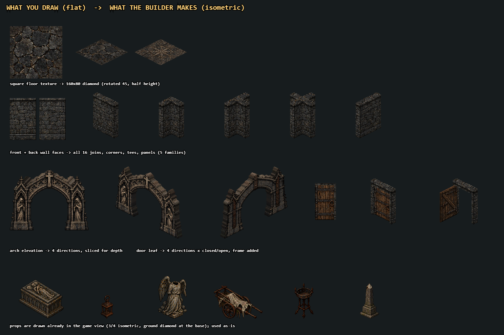

# New dungeon biomes from ChatGPT sprite sheets

A dungeon biome pack is **236 game sprites**: 60 floors, 5 wall families x 20 joins, 3 arches x 4 directions,
3 doors x 4 directions x open/closed, and 40 props. ChatGPT doesn't have to draw any of the hard isometric pieces.
It paints **9 flat sheets**, and the Catacombs pack's own builder (`tools/build_pack.py` inside
`assets/source/biomes/Catacombs_Biome_Pack.zip`) projects them into every wall join, corner, arch and door with
exact geometry. This is how the Catacombs pack itself was made.



## The kit (`docs/biome_kit/`)

| # | File (template + example) | Size | What ChatGPT paints |
|---|---|---|---|
| 1-4 | `1_floors_01-16.png` ... `4_floors_49-60.png` | 1024 x 1024 | 60 square, top-down floor textures, 4 x 4 per sheet |
| 5 | `5_wall_faces.png` | 1536 x 1024 | 5 wall surfaces, front (top row) + back (bottom row), flat elevation |
| 6 | `6_arches.png` | 1536 x 1024 | 3 archways, front + back, flat elevation, on magenta |
| 7 | `7_door_leaves.png` | 1536 x 1024 | 3 door leaves (the panel only), front + back, on magenta |
| 8-9 | `8_props_01-20.png`, `9_props_21-40.png` | 1536 x 1024 | 40 props, already in the game's isometric view, on magenta |

- `templates/` are the blank layouts. Cyan lines are the **bounding outlines**: cell borders, the exact box each
  arch and door must fill, and for props a box (max height) plus the ground diamond the prop stands on.
- `examples/` are the same layouts filled with the real Catacombs art (un-projected from the shipped sprites).
- `biome_names_template.json`: the names ChatGPT fills in (see "The names file" below).
- Regenerate the kit: `node tools/chatgpt_biome_kit.js <extracted Catacombs_Biome_Pack dir>`.

**Attach both the template and the example for each sheet** and paste the matching prompt below.
Do one sheet per message, in order, in one chat, so the style stays consistent.

---

## Step 0: paste this first (style bible)

Replace the bracketed part with your biome.

```text
We are making art for VELSCOUR, a retro isometric pixel-art action RPG in the style of Diablo II.
New dungeon biome: [NAME] - [materials, mood, culture, colour accents; e.g. "a drowned elven temple:
green-black basalt, verdigris bronze, pale coral, kelp, bioluminescent teal accents"].

Rules for every image I ask for:
- Crisp pixel art with hard edges, a dark grimdark palette, light from the upper left. No anti-aliased halo,
  no blur, no painterly soft edges, no glow that bleeds outside an object.
- Follow the attached TEMPLATE exactly: same canvas size, same grid, same cell order. The cyan lines are
  bounding outlines: fill or fit inside them. The attached EXAMPLE shows how a finished sheet looks
  (Catacombs biome); match its layout and level of detail, but invent new art for our biome.
- Remove ALL guide marks from the output: no cyan lines, no labels, no numbers, no text, no grid lines,
  no borders, no frames, no watermark.
- Where a sheet has a magenta background, keep the background pure flat magenta #FF00FF (or real
  transparency). No shadows, gradients, floor patches or texture on the background. Objects must not touch
  each other or the cell edges; leave clear magenta between them.
- Every cell is a different design. Keep one consistent palette and style across all sheets.
Reply "ready" and wait for the first sheet.
```

---

## Sheets 1-4: floors (60)

Square, **top-down** textures, as if photographed straight down. The game rotates each square 45 degrees and
squashes it to half height to make a 160 x 80 diamond, so **don't draw them in perspective or as diamonds**.
The square's top-left corner becomes the diamond's top point.

- **01-10 BASE materials** (sheet 1, first 10 cells): plain paving that must **tile seamlessly** with itself
  (left edge continues into right, top into bottom). Even lighting, no vignette, no big central motif.
  Ten different materials (flagstone, cobbles, bricks, slabs, gravel, tesserae, ...).
  Bases 01, 03, 06 and 09 are also painted on the **tops of the walls**, so make those plausible stone/masonry.
- **11-60 FEATURE tiles**: the base material named under the cell (`FEATURE on base N`) with one feature
  centred inside the dotted circle: cracks, drains/grates, sigils/seals, mosaics, inlays, stains, blood, debris,
  roots/growth, bones, metal plates, carved reliefs, puddles. Each base gets 5 features. The rim of each feature
  tile should still look like its base so it sits naturally among the paving.
- Sheet 4 has 12 floors and 4 cells marked UNUSED: leave those empty/black.

Prompt (change the numbers per sheet):
```text
Sheet 1 of 9: FLOORS 01-16. Attached: template and example. 1024x1024, a 4x4 grid of 256x256 square cells,
filled edge to edge with no gaps or borders. Top-down square floor textures (not isometric, not diamonds).
Cells 01-10 are seamless repeating base materials for our biome; cells 11-16 are feature tiles: the base material
named in the template with one centred feature. [Optional: list what you want in each cell.]
```
Sheets 2-4: "FLOORS 17-32 / 33-48 / 49-60, all feature tiles on the base named in each cell".

## Sheet 5: wall faces (5 families)

A wall face is a **flat, straight-on elevation** of one wall-tile's worth of wall: 1 tile wide, 1 wall tall
(cell aspect 5:8). Fill each cell completely. The **left and right edges must tile** (the builder repeats the face
along long walls). Draw the bottom 10-15% as a plinth/base course meeting the floor. **Top row = room-facing side
(FRONT), bottom row = the same wall's other side (BACK)**; keep material and colour the same, change the
decoration (the Catacombs ossuary family has bone niches in front, a plain wall with a slit behind).

The five families should be clearly different: e.g. plain ashlar, niches, carved chapel panel, barred cells,
ruined/overgrown. The first family is the most common (half the walls), so keep it the plainest.

```text
Sheet 5 of 9: WALL FACES. Attached: template and example. 1536x1024, 5 columns x 2 rows, each cell 307x512
filled edge to edge. Flat front elevations (no perspective, no isometric). Top row: the room-facing side of
5 different wall families for our biome. Bottom row: the back side of the same 5 walls (same material, simpler
decoration). Left and right edges of every cell must tile seamlessly. Plinth at the bottom of each cell.
```

## Sheet 6: arches (3 designs)

A flat front elevation of a free-standing archway, **3 tiles wide outer span** (piers included). The arch
must **exactly fill its cyan box**: piers' outer edges touch the box's left and right sides, pier feet sit on the
yellow ground line, the top touches the top edge. The opening (dashed) is where heroes walk through; it can be
round, pointed, flat or segmental, but must be clear magenta all the way down to the ground. Bottom row = the back
of the same arch: **identical silhouette**, simpler decoration. Heights: arch 1 = 160, 2 = 184 (tallest, grandest),
3 = 144 (squat, heavy).

```text
Sheet 6 of 9: ARCHES. Attached: template and example. 1536x1024 on flat magenta #FF00FF. Three archway designs
for our biome, each a flat straight-on elevation that exactly fills its cyan bounding box (piers touching the box
sides, feet on the ground line, top touching the box top). The opening must be empty magenta down to the ground.
Top row front faces, bottom row back faces with the identical outline. No perspective, no side faces, no shadows.
```

## Sheet 7: door leaves (3 designs)

Only the **door panel** (the swinging leaf), not the frame: the builder adds the jambs and lintel from wall
family 1 (door 1), 4 (door 2) and 2 (door 3). Fill the cyan box exactly (4:7, a full rectangle or nearly so).
Openwork (bars, grilles) is fine: leave magenta in the holes. Front row = outside face, back row = inside face of
the same door (bracing, hinges, bolts). Door 1 = common wooden/plain, door 2 = barred/metal, door 3 = ornate.

```text
Sheet 7 of 9: DOOR LEAVES. Attached: template and example. 1536x1024 on flat magenta #FF00FF. Three door
panels for our biome, each a flat straight-on rectangle exactly filling its cyan box. No door frame, no wall, no
perspective. Top row front faces, bottom row back faces of the same doors (same outline, hinges and bracing).
```

## Sheets 8-9: props (40)

Props are drawn **already in the game's view**: 3/4 isometric from the south-east, the object's base sitting on
the dashed ground diamond, fitting inside the dashed box (the box width is the prop's width in game, its height is
the maximum). One object per cell, no cast shadow on the background, small rubble/base pieces must touch the
object. Each cell's label is its role; invent a biome-appropriate version.
`[LIGHT]` props get a light and flame in game; `*` props are walk-over clutter (low and flat).

| # | Role | # | Role |
|---|---|---|---|
| 01 | large tomb / coffer | 21 | closed coffin / crate |
| 02 | open large container | 22 | broken open coffin / crate |
| 03 | fallen lid / slab | 23 | cart / wagon (widest) |
| 04 | pile of skulls / trophies | 24 | basin / font |
| 05 | low debris heap * | 25 | brazier [LIGHT] |
| 06 | remains lying flat * | 26 | torch stand [LIGHT] |
| 07 | tall urn / jar | 27 | cluster of urns |
| 08 | broken pot | 28 | rolled cloth / bedroll * |
| 09 | chest / strongbox | 29 | heap of planks * |
| 10 | small floor lantern [LIGHT] | 30 | chains & shackles * |
| 11 | candle cluster [LIGHT] * | 31 | leaning slab / seal |
| 12 | candelabrum [LIGHT] | 32 | obelisk (tall; also the boss-arena columns) |
| 13 | altar | 33 | corbel / bracket |
| 14 | lectern / pedestal | 34 | small idol |
| 15 | kneeling figure statue | 35 | offering bowl * |
| 16 | standing statue | 36 | bell / gong |
| 17 | fallen column | 37 | fallen railing / fence |
| 18 | column stump | 38 | bench |
| 19 | rubble pile | 39 | small book / tool clutter * |
| 20 | grave marker / small stele | 40 | boots / belt / small kit * |

```text
Sheet 8 of 9: PROPS 01-20. Attached: template and example. 1536x1024 on flat magenta #FF00FF, 5 columns x 4 rows.
One isometric 3/4-view pixel-art prop per cell for our biome, standing on the dashed ground diamond and fitting
inside the dashed box, same camera angle as the example. The role of each cell is in the template label:
[paste roles 01-20, or your own list]. No cast shadows, nothing touching the cell edges or another prop.
```
Sheet 9 is the same for 21-40.

## The names file

Last message to ChatGPT (attach `biome_kit/biome_names_template.json`):
```text
Fill in this JSON for the art you made: biome_name, then a short lowercase_underscore name for every floor,
wall family, arch, door and prop, in sheet order. Names must be unique. Light props should include one of:
lantern, candle, candelabrum, brazier, torch.
```

---

## Checklist before importing
- 9 PNGs at the sizes above, named `1_...` to `9_...`, plus the filled JSON.
- No text, numbers or cyan lines in the art; magenta (or transparent) backgrounds on sheets 6-9.
- Floors 01-10 tile (ChatGPT often adds a vignette: ask it to "remove the vignette, flat even lighting").
- Arches fill their boxes; arch openings and door grilles are magenta, not dark paint.
- Props: no two touching; nothing cut off by the cell edge.
Small misalignment is fine: the import step crops cells, keys out magenta and rescales each piece to its box.

## Importing (`tools/chatgpt_biome.py`)
Put the 9 images (any of png/webp/jpg, names starting with their sheet number) and the filled names JSON in one
folder, then (needs Python 3.10+ with `pillow numpy scipy`):
```bash
python tools/chatgpt_biome.py <folder> <folder>/names.json                # prep + build, nothing in the repo changes
python tools/chatgpt_biome.py <folder> <folder>/names.json --install      # + zip to assets/source/biomes and import
```
1. **Prep**: rescales each sheet to its template size, keys out magenta/transparency (and the magenta-tinted
   fringe), crops each texture cell 3-4% inside its border, keeps the largest object per object cell plus pieces
   within reach of it, and repacks everything into the builder's layout (`<folder>/build/source/`). Look at
   `build/prep_preview.png`: every extracted floor, wall face, arch, door and prop on grey. It stops with the cell
   number if a cell is empty.
2. **Build**: runs the Catacombs pack's builder (`tools/build_pack.py` from the zip) into
   `build/<Name>_Biome_Pack/` and prints its QA (seamless floors, wall joins, arch sockets, door hinges,
   inventory). Look at `qa/` and `reference_sheets/` there.
3. **--install**: zips it to `assets/source/biomes/<Name>_Biome_Pack.zip` (`--force` to replace) and runs
   `tools/process_assets.py biomes <name>` -> `assets/tiles/<name>/`.
4. Then by hand: point biomes at it in `ART` (`src/data/biomes.js`, `{ pack: '<name>' }`), add its light props to
   `LIT` (`src/world/dungeon.js`) and walk-over props to `WALK_OVER` (`tools/biomepack.py`), run `data_check.mjs`,
   `pack.js`, `walls.js` and `biome_survey.js`, and look at the screenshots.

Tested end to end with stand-in sheets (`node tools/chatgpt_biome_kit.js <pack dir> --clean <dir>` renders the
Catacombs examples without labels or outlines): 236 sprites, every builder QA check passes, and a dungeon renders
in game on the imported pack.

## Packs made this way
- **Sewers** (`assets/source/biomes/Sewers_Biome_Pack.zip` -> `assets/tiles/sewers/`): the first real ChatGPT pack, used
  as drawn (no palette) by the Fetid Sewers biome (`ART.sewers` in `src/data/biomes.js`). Its light props are in `LIT`
  and its flat clutter in `WALK_OVER`. Imported from the normalized 1024/1536 sheets. Those sheets had a thin pale frame
  around the prop sheets, so prep now ignores a 4 px border on object sheets.
- **Shattered Citadel, Hell, Crystal Castle** (`shattered_citadel`, `hell`, `crystal_castle`): used as drawn by the
  Shattered Citadel, HELL and the new Crystal Castle biome. The Crystal Castle leaves out its two maroon floors (7, 23).
  Hell keeps its approved painted floors and props on top.
- **Velscour's Castle** (`velscours_castle`): the new Velscour's Castle biome, and the depth-500 throne (only the
  ashlar, banner and lion walls and the marble, checker and inlay floors, darkened). ChatGPT put 12 floors on sheet 2 and
  16 on sheet 4, and no names file came with it, so the sheets were repacked and named by hand before import.
- **Velscour's Temple** (`velscours_temple`): the new Velscour's Temple biome. It came as reference atlases. Its wall
  faces were on magenta, so they were made opaque: the ragged tops were trimmed and the holes filled from the plain panel.
  Its plain paving moved into floors 01-10, and its own prop widths are in `scatter_widths_px`, because sheet 9 doesn't
  follow the role order.
- Palette-swap biomes now on these packs: Plague Sewers (Sewers, green), Crystal Caverns (the Crystal Castle's geode
  and vein walls, cyan), Storm Spire (Shattered Citadel, blue), Molten Depths (Hell's lava floors and ember walls without
  its sigils, orange), Gilded Tomb (Velscour's Temple, gold).
- Prep now also drops guide marks on object sheets: pale grid lines across the sheet and the white labels ChatGPT copies
  into each cell. Door leaves keep every piece in the cell, because a barred gate is many separate bars.
