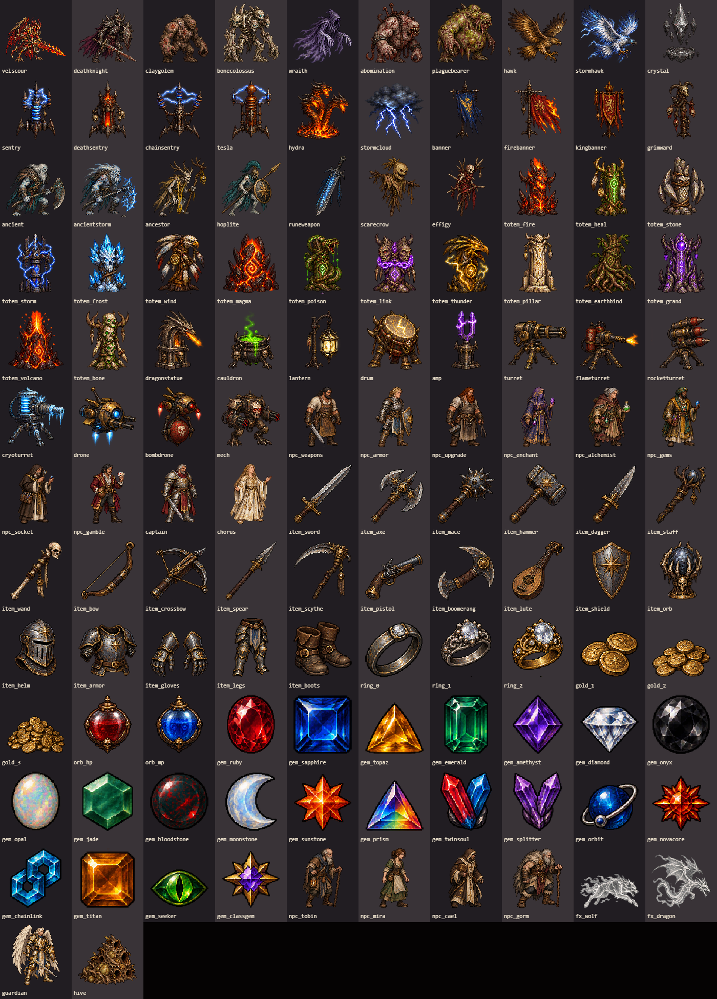

# Painted placeholder replacements

This pass replaces the sprites still used as placeholders on `main` at `f38ad522` (PR #45).
The older `PLACEHOLDER_ART.md` predates the familiar imports and includes a much larger
art expansion. The user selected **currently used placeholder sprites** for this PR.

## Coverage

| Runtime use | New sprites | Integration |
|---|---:|---|
| Demon Lord Velscour and raid ward crystal | 2 | Boss keeps its existing scale, attacks and collision; wards retain elemental tint |
| Summons without painted art | 56 | Each `SUMMONS` entry now has its own `look.art`; includes totems, machines and spectral allies |
| Town vendors and villagers | 12 | Eight named vendors and Tobin, Mira, Cael and Gorm |
| Generic equipment | 21 | Weapons, offhands, armor fallback, gloves, legs, boots; existing class/gear libraries take precedence |
| Gems | 21 | One drawing per kind, existing tier size and post-Royal halo/stars retained |
| Rings | 3 | Increasing ornament by rarity, augment color tint |
| Gold and recovery globes | 5 | Three pile sizes, health and mana |
| Wolf/dragon projectile silhouettes | 2 | Painted silhouettes with the skill's elemental tint |
| **Total** | **122** | |

All 56 previously unpainted summons are covered. Mirror Image intentionally copies the
hero. Revive intentionally uses the corpse. Existing painted monsters, skeleton minions,
familiars (including the blue slimes), heroes, gear libraries, class-select art, Paladin
art, terrain packs, chests, gibs, logo, HUD and potion art are preserved.

ASCII monster/decor fallbacks remain for missing/loading assets. The dungeon decor fallback
is used only if a biome has no scatter art; current packs have scatter. Procedural spell
shapes, particles, telegraphs, aura animation, general skill icons and UI frames remain.
The proposed 24 biome packs, 900 class effects, 980 dedicated skill icons and full character
animation sets are outside this sprite replacement pass. Existing palette swaps of supplied
art are not classified as Claude-generated drawings.

## Sources and regeneration

Generated with the built-in `image_gen` tool, using the project's supplied demon sheet
and sixteen-class sheet as visual references. Source PNGs, reading-order IDs and world
heights live in `assets/source/replacements/`; see its `README.md` for the prompt set.

```sh
python tools/replacementart.py
```

Requires Pillow and numpy. The importer crops the source grids, uniformly downsizes with
nearest-neighbor sampling, preserves RGBA, adds two-pixel atlas gutters and writes
`assets/sprites/replacements/atlas.webp`, `atlas.json`, and `src/data/replacementart.js`.
Never hand-edit those outputs. Individual guardian and hive drawings supersede their early
sheet concepts; unused cells are omitted from the catalog.

The 1024-wide lossless atlas is about 3 MB (roughly 9 MB decoded), loaded before the menu
can open. `src/core/replacementart.js` caps its derived canvas cache at 192 entries.
Paths are relative for GitHub Pages. The existing enemy renderer supplies flips, bobbing,
hit flashes and corpse shading; no combat/save data changes are made.

## Validation

- `data_check.mjs`: 980 skills, summons, existing art catalogs and biome data pass.
- `replacementart.js`: all 122 cuts load, all 56 summon mappings render painted art,
  dimensions/alpha/hit flashes/corpse variants and inventory sizes pass; produces a full gallery.
- `skills.js`: all 16 classes / 980 skills, no errors.
- `flow.js`, `boss.js`, `raid.js 5`, `town.js 1337`, `ui.js`, `mobile.js`, `hud.js`: pass.
- The UI test now waits for Escape to be processed before opening the next panel, and
  explicitly verifies sapphire fusion rather than swallowing a failed click.
- Screenshots reviewed: full gallery, Velscour, inventory, town and mobile UI.

Tests ran in desktop Chromium. `TEST_FROM_DISK=1` in the harness routes local files through
Playwright at the normal HTTP URLs when a sandbox cannot expose a loopback port. Native
Safari/iOS and Firefox are not verified. Art is still single-frame, with the existing motion.


