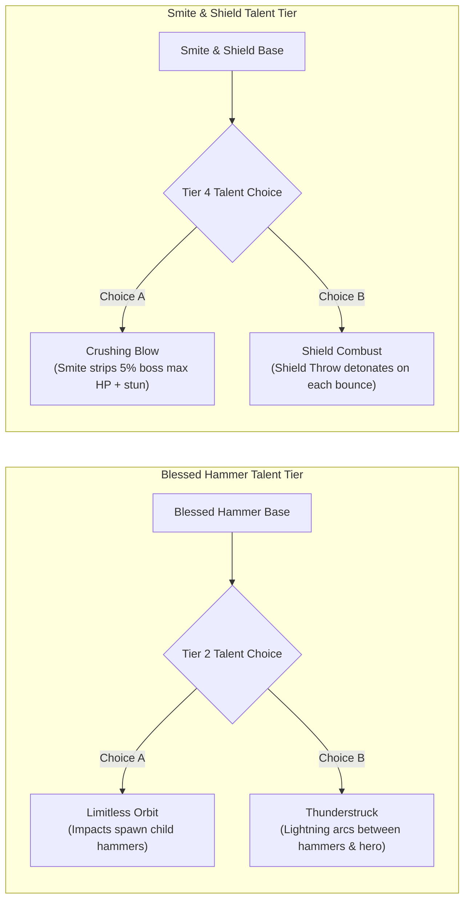

# Paladin: Skill Tree Pruning & Talent Overhaul Plan (Pass 2 - ARPG Game Dev Revision)

## 1. Design Vision & Diablo II / III ARPG Pillars
In classic ARPG design (*Diablo II* and *Diablo III: Reaper of Souls*), the Paladin/Crusader is the ultimate armored holy juggernaut. Every skill on their bar must deliver **tactile weight**, **distinct weapon/shield identity**, and **clear combat loop roles** (Generator, Spender, Mobility, Active Aura, Apex Super).

### The Four Iconic Archetypes:
1. **The Hammerdin (Holy Caster)**: Master of orbital trajectories and holy ballistics (*Blessed Hammer, Holy Bolt, Fist of the Heavens*). Relies on positioning, spacing, and projectile geometry.
2. **The Smiter & Bulwark (Shield Tank / Thorns)**: Weaponizes the shield (*Smite, Blessed Shield, Holy Shield*). Unmatched boss-lockdown, 100% hit reliability, crowd control, and retaliatory Thorns damage.
3. **The Zealot & Avenger (Melee Combatant)**: Relentless melee weapon flurries (*Zeal, Vengeance, Condemn*). Infuses martial strikes with pure elemental wrath (Fire, Cold, Lightning) and gathers packs into holy detonations.
4. **The Radiant Ascendant (Holy Wrath / Archon)**: High-cooldown holy bombardments and celestial transformations (*Heaven's Fury, Falling Sword, Avatar of the Dawn*).

---

## 2. Bloat Diagnosis: What Went Wrong in the Old 80-Skill Tree
* **Diluted Identity & Skill Reskins**:
  * **6 Spiral Projectiles**: Instead of one satisfying *Blessed Hammer*, players had *Blessed Hammer, Hammerstorm, Wheel of Hammers, Choir of Blades, Swords of Light, and Halo Toss* on their bar.
  * **Redundant Melee Strikes**: *Smite, Zealous Strike, Zeal, Crusader's Flurry, Cleanse Blade, Dawnblade, Sweep, and Final Judgment* were minor number tweaks on the same sword swing.
  * **Class Bleed / Barbarian Overlap**: The old tree gave the Paladin *Templar's Whirl* (a Barbarian Whirlwind reskin). Paladins don't spin like tops—they plant their boots, raise their shields, and crush evil with deliberate holy wrath!
  * **Shield Identity Confusion**: *Smite* was incorrectly tagged as a basic sword attack, while *Shield Bash* was a separate button. In authentic ARPG design, *Smite* **is** the shield strike that uses Shield Defense as weapon damage and cannot be dodged.

---

### Architecture Clarification: Tree Capstones vs The F-Key Class Ultimate (Divine Smite)

> [!IMPORTANT]
> **No, Level 30 Tree Capstones DO NOT replace Divine Smite!**
> 
> Dagyr-Online uses a dual-layer ultimate architecture:
> 1. **The Class Ultimate (`Divine Smite` on Key `F` / HUD Orb)**:
>    * Belongs to `src/game/smite.js`.
>    * Starts permanently unlocked from Level 1.
>    * Has its own dedicated circular HUD meter filled by monster kills (45 kills to charge).
>    * Costs **0 mana** and takes **0 skill bar slots**. It remains the Paladin's dedicated screen-clearing tactical nuke at all times.
> 2. **Level 30 Skill Tree Capstones (Hotbar Slots `1-8`)**:
>    * Abilities like *Avatar of Dawn* (Akarat's Champion form), *Bastion of Faith* (invulnerable tank fortress), and *Apocalypse of Light* are standard high-tier abilities learned with Skill Points.
>    * They are assigned to your normal `1-8` or `LMB/RMB` hotbar slots.
>    * They cost mana and have traditional cooldowns (30s to 60s).
>    * Calling them "Ultimates" in earlier notes was confusing terminology—in proper ARPG design, they are **Tree Capstones** (high-tier spenders and transformations), functioning alongside your F-key `Divine Smite`.
> 
> In fact, the overhauled Talent Tree can offer **synergy between them** (e.g. while in *Avatar of Dawn*, Divine Smite takes 30% fewer kills to charge!).

---

## 3. Pruned Active Skill Tree (9 Skills per Tree · 36 Core Skills)
The active skill tree is cut from **80 down to 36 meaningful abilities** organized into a clean 3x3 grid per tree (Row 0: Lv 1 Baseline, Row 1: Lv 12 Mid-Game, Row 2: Lv 24+ Capstones).

```
                      PALADIN ACTIVE SKILLS (36 Total)
 ┌──────────────────────┬──────────────────────┬──────────────────────┬──────────────────────┐
 │ Tree 0: Holy Wrath   │ Tree 1: Bulwark      │ Tree 2: Crusade      │ Tree 3: Ascension    │
 │ (Holy Caster)        │ (Shield & Auras)     │ (Melee & Vengeance)  │ (Archon & Wrath)     │
 ├──────────────────────┼──────────────────────┼──────────────────────┼──────────────────────┤
 │ 1. Holy Bolt (Proj)  │ 1. Smite (Shield)    │ 1. Zeal (Flurry)     │ 1. Dawnblade (Wave)  │
 │ 2. Blessed Hammer    │ 2. Holy Shield (Buff)│ 2. Vengeance (Elem)  │ 2. Lightwell (Heal)  │
 │ 3. Consecration      │ 3. Crusader Charge   │ 3. Condemn (Vacuum)  │ 3. Seraph Wings      │
 ├──────────────────────┼──────────────────────┼──────────────────────┼──────────────────────┤
 │ 4. Fist of Heavens   │ 4. Blessed Shield    │ 4. Holy Fire Blade   │ 4. Radiant Cascade   │
 │ 5. Judgment Beam     │ 5. Fanaticism Aura   │ 5. Sweep (Cleave)    │ 5. Solar Hammer      │
 │ 6. Sanctuary (Ward)  │ 6. Conviction Aura   │ 6. Inquisition (Hex) │ 6. Beacon of Valor   │
 ├──────────────────────┼──────────────────────┼──────────────────────┼──────────────────────┤
 │ 7. Purifying Nova    │ 7. Holy Freeze Aura  │ 7. Blade Barrage     │ 7. Falling Sword     │
 │ 8. Heaven's Fury     │ 8. Guardian Angel    │ 8. Final Judgment    │ 8. Wings of Judgment │
 │ 9. Apocalypse Light  │ 9. Bastion of Faith  │ 9. Crusade (Aura)    │ 9. Avatar of Dawn    │
 └──────────────────────┴──────────────────────┴──────────────────────┴──────────────────────┘
```

### Tree 0: Holy Wrath (Caster / Hammerdin)
* **Row 0 (Lv 1 - Core Caster Toolkit)**:
  1. **Holy Bolt** (Lv 1 · Projectile) — Fast piercing missile of holy energy. Damages undead/demons heavily and restores health to allies it passes through.
  2. **Blessed Hammer** (Lv 1 · Orbit) — Conjures a spinning golden warhammer that spirals outward from the Paladin, damaging all enemies in its path.
  3. **Consecration** (Lv 6 · Ground Zone) — Blesses the earth in a wide circle. Allies standing inside regenerate health; enemies suffer holy burn damage.
* **Row 1 (Lv 12 - Area Bombardment)**:
  4. **Fist of the Heavens** (Lv 12 · Strike/AoE) — Calls down a thunderous lightning bolt from the heavens onto target location; upon impact, bursts into a spray of outward-flying Holy Bolts.
  5. **Judgment Beam** (Lv 12 · Channeled Beam) — Channels a focused ray of searing sunlight piercing all enemies in a line.
  6. **Sanctuary** (Lv 16 · Zone/Ward) — Consecrated ward that knocks back undead and prevents enemies from entering while granting the Paladin crowd-control immunity.
* **Row 2 (Lv 24 - Apex Caster Capstones)**:
  7. **Purifying Nova** (Lv 20 · Nova) — Expanding shockwave of blinding light that pushes all enemies back and blinds them for 3s.
  8. **Heaven's Fury** (Lv 24 · AoE/Beam) — Calls down a roaming pillar of concentrated holy fire that tracks the cursor or highest-health elite monster.
  9. **Apocalypse of Light** (Lv 30 · Rain/Capstone) — Channels continuous orbital holy bombardments across the entire battlefield for 8 seconds.

### Tree 1: Bulwark (Shield Combat & Active Auras)
* **Row 0 (Lv 1 - The Smiter & Defender)**:
  1. **Smite** (Lv 1 · Melee Shield) — Smashes the enemy with your shield. **Uses Shield Defense as base damage**. Cannot be dodged or blocked; always stuns for 1.2s and knocks back.
  2. **Holy Shield** (Lv 1 · Buff) — Imbues your shield with divine energy, drastically increasing Block Chance, Armor, and Smite damage for 60 seconds.
  3. **Crusader's Charge** (Lv 6 · Dash Mobility) — Lowers the shield and charges forward at high speed, trampling monsters and breaking through crowds.
* **Row 1 (Lv 12 - Active Auras & Captain America Shield)**:
  4. **Blessed Shield** (Lv 12 · Projectile/Ricochet) — Flings a spectral tower shield that ricochets between up to 5 enemies with heavy metallic impacts.
  5. **Fanaticism Aura** (Lv 16 · Aura) — *Passive*: Grants +20% Attack Speed and +15% Damage to Paladin and party. *Active Cast*: Emits a war bellow granting +50% Attack Speed and +30% Move Speed for 6s (30s CD).
  6. **Conviction Aura** (Lv 16 · Aura) — *Passive*: Emits a green sigil aura that strips 30% of nearby enemies' Armor and Elemental Resistances. *Active Cast*: Strips all elemental immunities and applies Vulnerability for 6s.
* **Row 2 (Lv 24 - Retaliation & Living Citadel)**:
  7. **Holy Freeze Aura** (Lv 20 · Aura) — *Passive*: Periodically pulses cold damage that slows enemy movement and attack speed by 40% in an aura. *Active Cast*: Flash-freezes all nearby foes solid for 3s.
  8. **Guardian Angel** (Lv 24 · Summon) — Summons an Archangel sentinel that taunts bosses and casts divine shields over wounded allies.
  9. **Bastion of Faith** (Lv 30 · Defensive Capstone) — Plants shield into the ground: Paladin gains 100% Block Chance, 80% Damage Reduction, and reflects 300% Thorns damage for 10s.

### Tree 2: Crusade (Melee Flurries, Vengeance & Condemn)
* **Row 0 (Lv 1 - Martial Zeal)**:
  1. **Zeal** (Lv 1 · Melee Flurry) — Unleashes a rapid flurry of 5 consecutive melee swings with escalating attack speed and hit accuracy.
  2. **Vengeance** (Lv 1 · Melee Elemental) — Strikes an enemy, infusing your weapon with simultaneous Fire, Cold, and Lightning damage.
  3. **Condemn** (Lv 6 · Area Vacuum) — Channels holy energy for 2.5s, vacuuming all surrounding enemies toward the Paladin, then detonates in a massive holy explosion.
* **Row 1 (Lv 12 - Tactical Cleaves & Holy Judgments)**:
  4. **Holy Fire Blade** (Lv 12 · Melee/Burn) — Sweeping swing that sets weapon ablaze, causing melee hits to ignite enemies in lingering holy fire.
  5. **Sweep / Slash** (Lv 16 · Melee Cleave) — Wide 180-degree sweep dealing high physical damage and building Fervor stacks.
  6. **Inquisition** (Lv 16 · Curse/Sigil) — Condemns a target with a brand of heretic's punishment; damage dealt to the target splashes to all nearby foes.
* **Row 2 (Lv 24 - Crusader Executions)**:
  7. **Blade Barrage** (Lv 20 · Projectile/Swords) — Conjures a fan of 7 glowing spectral longswords and launches them forward in a piercing wave.
  8. **Final Judgment** (Lv 24 · Melee Execution) — Heavy two-handed overhead execution slam dealing triple damage to enemies below 30% HP.
  9. **Crusade Avatar** (Lv 30 · Buff/Capstone) — Enters a state of unstoppable crusade: attacks cleave in 360 degrees and regenerate 5% health per hit for 15s.

### Tree 3: Radiant Ascension (Ascendant / Archon)
* **Row 0 (Lv 1 - Radiant Fundamentals)**:
  1. **Dawnblade** (Lv 1 · Melee/Wave) — Basic strike releasing a crescent wave of pure light on every swing.
  2. **Lightwell** (Lv 1 · Deployable) — Conjures a holy chalice of light that party members can touch to immediately restore 50% HP.
  3. **Seraph Wings** (Lv 6 · Dash/Flight) — Unfurls radiant wings, darting forward instantaneously and leaving consecrated ground.
* **Row 1 (Lv 12 - Solar Miracles)**:
  4. **Radiant Cascade** (Lv 12 · Chain Lightning) — Hurls a bolt of solar light that arcs between up to 6 enemies.
  5. **Solar Hammer** (Lv 16 · AoE Slam) — Giant celestial hammer drops from orbit, crushing the zone and leaving molten glass.
  6. **Beacon of Valor** (Lv 16 · Party Aura) — Increases party Critical Strike Chance by 15% and Critical Strike Damage by 50%.
* **Row 2 (Lv 24 - Ascendance & Falling Sword)**:
  7. **Falling Sword** (Lv 20 · Leap/Plunge) — **The Crusader Iconic Leap**: Launches high into the heavens, becoming untargetable, then crashes down like a meteor with devastating holy force.
  8. **Wings of Judgment** (Lv 24 · Rain/Stars) — Rains falling celestial starlight over a wide area, blinding and burning targets.
  9. **Avatar of Dawn (Akarat's Form)** (Lv 30 · Form Capstone) — Transforms into a towering golden Avatar: size increased by 40%, crowd control immune, cooldowns tick twice as fast, and fatal damage is completely absorbed once.

---

## 4. Overhauled Talent Tree: A/B Skill Morphs (Diablo III Style)
The Talent Tree is where skills are modified. Instead of clogging the hotbar with 5 dash skills or 6 hammer variants, **players spend talent points to fundamentally evolve their core active skills**.



### Branch 0: Holy Wrath (The Hammerdin & Caster Branch)
* **Tier 1 (Lv 1 - Foundation)**: *Radiant Fervor* (5 ranks)
  * +6% Holy Damage, +3% Cast Speed, +15 Max Mana per rank.
* **Tier 2 (Lv 10 - A/B Skill Morph: Blessed Hammer)**:
  * **Choice A (Limitless Hammerstorm)**: Blessed Hammer impacts have a 50% chance to summon a new secondary hammer at the target's location, creating an escalating spiral storm.
  * **Choice B (Thunderstruck Tether)**: Blessed Hammer crackles with lightning; continuous electrical arcs link the Paladin to all active orbiting hammers, zapping everything in between.
* **Tier 3 (Lv 24 - Synergy)**: *Vigor & Blessed Aim* (5 ranks)
  * +5% Movement Speed, +8% Critical Strike Damage, +10% Cooldown Reduction for Holy Wrath skills per rank.
* **Tier 4 (Lv 40 - A/B Skill Morph: Fist of the Heavens)**:
  * **Choice A (Holy Bolt Fissure)**: Fist of the Heavens impact releases 8 piercing Holy Bolts in all directions that seek enemies and heal party members for 15% of damage dealt.
  * **Choice B (Divine Wellstorm)**: Fist of the Heavens creates a persistent lightning storm at the impact point that tethers enemies with chain lightning for 6 seconds.
* **Tier 5 (Lv 60 - Apex Keystone)**:
  * **Choice A (Aegis of Valor)**: Casting Fist of the Heavens grants a buff making your next 3 Blessed Hammers fire simultaneously in a trident formation.
  * **Choice B (Archon of Light)**: Purifying Nova triggers automatically whenever you critically hit with any holy spell (3s internal CD); +30% Holy Spell Damage.

### Branch 1: Bulwark (The Smiter & Thorns Crusader Branch)
* **Tier 1 (Lv 1 - Foundation)**: *Defiance & Faith* (5 ranks)
  * +8% Armor, +4% Maximum Life, +2% Shield Block Chance per rank.
* **Tier 2 (Lv 10 - A/B Skill Morph: Crusader's Charge & Steed)**:
  * **Choice A (War Steed Trample)**: Crusader's Charge summons a celestial warhorse: you can steer the charge for 4 seconds, trampling and knocking down all enemies in your path.
  * **Choice B (Shield Ram Impact)**: Crusader's Charge ends in an explosive shield slam that stuns the target area for 2.5 seconds and triggers an automatic free Smite.
* **Tier 3 (Lv 24 - Synergy)**: *Iron Maiden Thorns* (5 ranks)
  * +30% Thorns Damage per rank; 25% of your total Thorns damage is added directly to Smite and Blessed Shield damage.
* **Tier 4 (Lv 40 - A/B Skill Morph: Blessed Shield)**:
  * **Choice A (Combusting Aegis)**: Blessed Shield gains +4 extra bounces, and each bounce triggers a concussive holy fire explosion.
  * **Choice B (Shattering Shards)**: When Blessed Shield strikes an enemy, it fractures into 3 smaller bucklers that ricochet independently across the room.
* **Tier 5 (Lv 60 - Apex Keystone)**:
  * **Choice A (Smiter's Crushing Blow)**: Smite ignores 100% of target defense and deals an additional 5% of elite/boss maximum health as bonus damage.
  * **Choice B (Invoker's Retribution)**: Blocking an attack or taking a melee hit immediately strikes the attacker with a holy lightning bolt for 350% Thorns damage.

### Branch 2: Crusade (The Zealot & Avenger Branch)
* **Tier 1 (Lv 1 - Foundation)**: *Righteous Zeal* (5 ranks)
  * +7% Melee Physical/Elemental Damage, +3% Attack Speed per rank.
* **Tier 2 (Lv 10 - A/B Skill Morph: Zeal)**:
  * **Choice A (Fanatic Flurry)**: Zeal hit count increased from 5 to 8 swings, and each consecutive swing increases Attack Speed by an additional 10%.
  * **Choice B (Cleaving Wrath)**: Zeal strikes in a wide 180-degree cleaving arc, applying a stacking bleed that ruptures on the 5th strike.
* **Tier 3 (Lv 24 - Synergy)**: *Elemental Avenger* (5 ranks)
  * +8% Fire/Cold/Lightning Damage per rank; striking with Vengeance grants +10% Resistance to that element for 10s.
* **Tier 4 (Lv 40 - A/B Skill Morph: Condemn)**:
  * **Choice A (Instant Vacuum Detonation)**: Condemn detonates immediately without delay, pulling all enemies within 12 meters instantly into melee range and stunning them.
  * **Choice B (Reciprocating Retaliation)**: Condemn triggers an automatic secondary detonation 3 seconds after the first, dealing 200% damage to all trapped foes.
* **Tier 5 (Lv 60 - Apex Keystone)**:
  * **Choice A (Avenging Executioner)**: Final Judgment instantly resets its cooldown if it kills any monster; critical strikes deal +50% bonus damage.
  * **Choice B (Crusader King's Fervor)**: Striking with Zeal reduces all active Paladin cooldowns by 0.5s per swing.

---

## 5. Diablo II / III Build Archetypes Enabled

### Archetype 1: Classic D2 Hammerdin
* **Core Active Skills**: Blessed Hammer + Holy Bolt + Consecration + Fanaticism Aura + Crusader's Charge.
* **Talents**: *Limitless Hammerstorm* + *Vigor & Blessed Aim* + *Holy Bolt Fissure* + *Aegis of Valor*.
* **Playstyle**: Charge into the center of a pack, lay down Consecration, and unleash limitless spiraling hammers. When distant elites cast spells, nail them with Fist of the Heavens to trigger Holy Bolt sprays that also heal allies.

### Archetype 2: Boss-Killer Smiter (The Uber-Smiter)
* **Core Active Skills**: Smite + Holy Shield + Crusader's Charge + Conviction Aura + Bastion of Faith.
* **Talents**: *Shield Ram Impact* + *Iron Maiden Thorns* + *Smiter's Crushing Blow*.
* **Playstyle**: Smite cannot miss and locks down bosses with 100% stuns and Crushing Blows. Holy Shield and Bastion of Faith make the Paladin completely impervious to burst damage.

### Archetype 3: Captain America (Blessed Shield Crusader)
* **Core Active Skills**: Blessed Shield + Smite + Crusader's Charge + Fanaticism Aura + Falling Sword.
* **Talents**: *War Steed Trample* + *Combusting Aegis* + *Invoker's Retribution*.
* **Playstyle**: Fling ricocheting shields into mob packs that explode with metallic clangs on every bounce. Gallop on the celestial warhorse between packs.

### Archetype 4: Elemental Zealot / Avenger
* **Core Active Skills**: Zeal + Vengeance + Condemn + Conviction Aura + Avatar of Dawn.
* **Talents**: *Fanatic Flurry* + *Elemental Avenger* + *Instant Vacuum Detonation* + *Crusader King's Fervor*.
* **Playstyle**: Vacuum the entire room into your blade with instant Condemn, then shred the pack with an 8-hit Fanatic Zeal flurry that resets all your cooldowns in seconds.

---

## 6. Hotbar & Quality-of-Life Comparison

| Metric | Old System (Bloated) | New ARPG System (Streamlined) |
| :--- | :--- | :--- |
| **Active Skills in Book** | 80 skills (mostly reskins) | **36 core, distinct abilities** |
| **Hammers on Hotbar** | 3-4 different hammer buttons | **1 customizable Blessed Hammer** |
| **Shield Skills on Hotbar** | 5 bashes and throws | **1 Smite + 1 Blessed Shield** |
| **Dashes / Mobility on Bar** | 3-4 duplicate charges | **1 Crusader Charge (Steed / Ram via Talent)** |
| **Aura Management** | Clunky passive stat buffs | **Dual-function: Passive Aura + Active Surge** |
| **Build Differentiation** | Swapping slightly different colored buttons | **Deep, mutually exclusive A/B Talent Morphs** |
